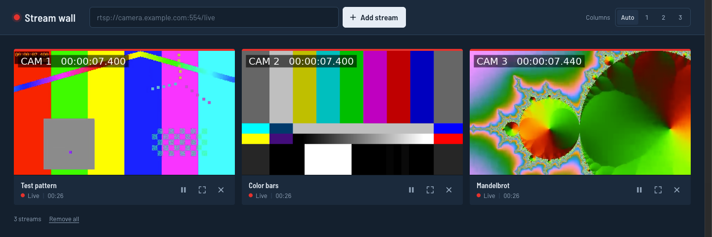
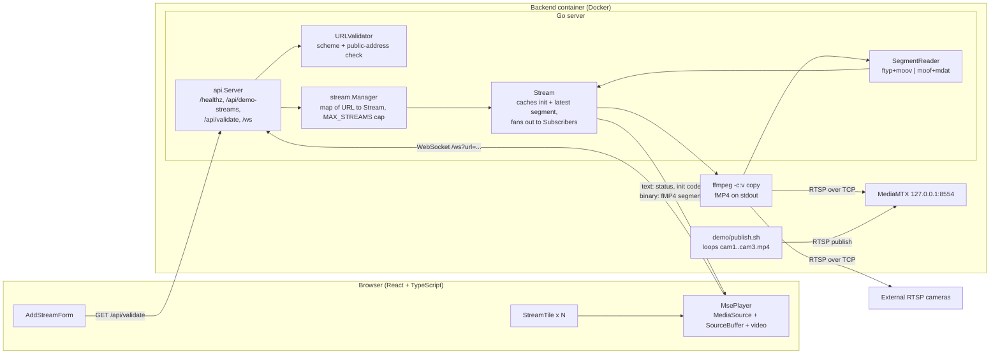

# RTSP Stream Viewer

Paste RTSP camera URLs into a web page and watch them live, side by side, without a desktop player.

## Demo

**Live:** https://rtsp-viewer.onrender.com (API: https://rtsp-viewer-api.onrender.com/healthz)

Click **Watch 3 demo streams** to load three test streams. They are served by a MediaMTX instance
running inside the backend container, so the demo needs no external camera.

> Both services run on Render's free tier, which puts the backend to sleep when it gets no
> traffic. The first visit after a quiet period shows "Starting the server" while it wakes, which
> can take up to a minute. Once it answers, streams start normally.



<!-- GIF: adding an RTSP URL, the tile going connecting to live, then pause/play and full screen. Save as docs/demo.gif -->

## What it does

- Accepts `rtsp://` and `rtsps://` URLs. The server validates each one (`GET /api/validate`) before
  a tile is created.
- Shows streams in a responsive grid: automatic or fixed 1, 2 or 3 columns, plus full screen per tile.
- Play and pause per tile. Pause keeps the last frame; play resumes at the live edge.
- Shows per-tile state: connecting, live, reconnecting (with the reason) and failed.
- Remembers the stream list and layout in `localStorage`.
- Reconnects on both sides: the server restarts FFmpeg with backoff (1 s to 30 s), and the browser
  reopens its WebSocket with backoff (1 s to 15 s).
- Masks passwords in URLs shown in the UI and redacts credentials from server logs.

## Architecture



- **Remux, not transcode.** FFmpeg runs with `-c:v copy` and fragmented-MP4 flags
  (`frag_keyframe+empty_moov+default_base_moof`), so the server never decodes video and the
  browser plays it natively through Media Source Extensions. The cost is that only H.264 is
  supported: the server reads the codec from the init segment and rejects H.265 and others with
  a clear message instead of retrying.
- **One FFmpeg per URL, not per viewer.** `stream.Manager` keeps one `Stream` per distinct URL and
  fans its segments out to every subscriber, so ten viewers of one camera open one RTSP session.
  The tradeoff is in-memory state per instance: scaling out would need requests routed by URL so
  all viewers of a camera land on the same instance.
- **Instant join.** Every media segment starts on a keyframe, and each `Stream` caches the init
  segment and the latest media segment, so a new viewer gets a playable picture without waiting
  for the next keyframe.
- **Slow viewers cannot block others.** Broadcasting never blocks. A viewer whose buffer is full
  skips whole segments (keyframe aligned, so no corruption) and is dropped after 10 s of falling
  behind. A source with no viewers keeps running for `IDLE_GRACE` (30 s) so refreshes do not
  restart FFmpeg.
- **Live-edge playback.** The player targets about 1.2 s behind the newest frame, plays at 1.08x
  when it drifts past 1.8 s, jumps forward if it falls more than 4 s behind, and keeps only about
  10 s of buffer per tile. End-to-end latency is roughly one GOP plus that target, so cameras with
  long keyframe intervals have more delay.
- **Demo inside the API container.** MediaMTX listens on loopback inside the backend container
  because Render's free tier cannot route private-network traffic between services.

### Wire protocol

```
text    {"type":"status","state":"connecting|live|reconnecting|failed","message":"..."}
text    {"type":"init","codec":"avc1.4d401e"}   followed by one binary init segment (ftyp+moov)
binary  media segment (moof+mdat), appended as-is to the SourceBuffer
text    {"type":"error","message":"..."}        followed by a close with an application code
```

Errors travel over the socket because browsers do not expose the HTTP response of a rejected
WebSocket handshake to page scripts. Close codes: `4400` invalid URL (not retried by the
browser), `4429` stream limit reached, `4408` viewer too slow to keep up.

### Error handling

| Situation | What the viewer sees |
|---|---|
| Malformed URL or wrong scheme | Inline form error, no tile created |
| Private, loopback or cloud-metadata address | Inline form error explaining why |
| Camera refuses, times out, 401, 404 | "Waiting for camera" with the reason; server retries with backoff, 1 s to 30 s |
| Camera connects but sends nothing for 25 s | Watchdog stops FFmpeg and retries (25 s allows long-GOP cameras) |
| FFmpeg restarts with a new init segment | Player rebuilds its decoder on the new init segment |
| Non-H.264 stream (e.g. H.265) | "Can't play this stream" with the codec; no retry loop |
| Browser cannot decode the codec, or has no MSE | Tile or page explains it |
| Backend asleep or unreachable | Banner while it wakes; WebSockets reconnect with backoff |
| Server at its stream limit | Tile explains and retries |

### Security

The server opens a connection to whatever URL a user types, so unchecked it would be an SSRF
proxy into the hosting network. `URLValidator` accepts only `rtsp://` and `rtsps://` and requires
every resolved address to be public: loopback, private, link-local (including
`169.254.169.254`), CGNAT, multicast and several reserved and IPv4-embedding IPv6 ranges are
rejected. The bundled demo server is allowed by exact `host:port` through `ALLOWED_RTSP_HOSTS`.
FFmpeg is started with an argument list, never a shell. WebSocket and CORS access is limited to
`ALLOWED_ORIGINS`.

Known gaps, both because FFmpeg makes its own connection after validation:

- **DNS rebinding.** A hostname that resolves differently between validation and FFmpeg's
  lookup is not caught. Pinning FFmpeg to the validated IP would break RTSPS certificate checks
  and host-based routing on some cameras.
- **RTSP redirects.** FFmpeg follows `3xx` redirects, so a public server could redirect it to a
  private address.

Closing both needs a network egress rule that blocks private ranges for the server process,
which the free hosting tier does not offer.

## Stack

- **Backend:** Go 1.26 (`log/slog`, `net/http`, `net/netip`), `github.com/coder/websocket`
- **Media:** FFmpeg (remux to fragmented MP4), MediaMTX 1.21.1 for the bundled demo streams
- **Frontend:** React 19, TypeScript, Vite, Media Source Extensions; Vitest with jsdom for tests
- **Deploy:** Docker (Alpine, `tini`), Docker Compose, Render Blueprint (`render.yaml`)

## Run it locally

### With Docker

```sh
docker compose up --build
```

Open http://localhost:5173 and click **Watch 3 demo streams**. The compose file sets
`ALLOW_PRIVATE_NETWORKS=true`, so you can also add cameras on your own network
(`rtsp://192.168.x.x/...`).

### Without Docker

Requirements: Go 1.26+, Node 22.12+, FFmpeg, MediaMTX (`brew install ffmpeg mediamtx`).

Terminal 1, demo RTSP server and three looping test streams on `rtsp://127.0.0.1:8554/cam1..3`:

```sh
mediamtx demo/mediamtx.yml &
./demo/publish.sh
```

Terminal 2, backend on `:8080`:

```sh
cd backend
DEMO_STREAMS="Test pattern=rtsp://127.0.0.1:8554/cam1,Color bars=rtsp://127.0.0.1:8554/cam2,Mandelbrot=rtsp://127.0.0.1:8554/cam3" \
ALLOWED_RTSP_HOSTS=127.0.0.1:8554 \
go run ./cmd/server
```

Terminal 3, frontend on `:5173`:

```sh
cd frontend
npm ci
npm run dev
```

No API keys are needed.

### Publishing your own test stream

Any video file can be pushed into the local MediaMTX as H.264:

```sh
ffmpeg -re -stream_loop -1 -i my-video.mp4 -c:v libx264 -g 25 -an \
  -f rtsp -rtsp_transport tcp rtsp://127.0.0.1:8554/mystream
```

Then add `rtsp://127.0.0.1:8554/mystream`. A short GOP (`-g` close to the frame rate) keeps
latency near one second, because a media segment is one GOP long.

### Configuration

Backend environment variables:

| Variable | Default | Purpose |
|---|---|---|
| `PORT` | `8080` | HTTP port |
| `ALLOWED_ORIGINS` | `localhost:*,127.0.0.1:*` | Comma-separated browser origins for WebSocket and CORS. Patterns use `path.Match`; include the scheme to match it exactly (`https://app.example.com`) |
| `MAX_STREAMS` | `6` | Maximum distinct RTSP sources running at once |
| `IDLE_GRACE` | `30s` | How long a source keeps running after its last viewer leaves |
| `ALLOWED_RTSP_HOSTS` | (empty) | `host:port` pairs exempt from the public-address check |
| `ALLOW_PRIVATE_NETWORKS` | `false` | Allow private and LAN cameras (local use only) |
| `DEMO_STREAMS` | (empty) | `Name=url,Name=url` offered by the UI's demo button |
| `FFMPEG_PATH` | `ffmpeg` | FFmpeg binary |
| `ENABLE_DEMO` | `true` (container only) | Read by `docker/entrypoint.sh`: start the bundled MediaMTX and publishers |

Frontend build variable: `VITE_API_URL`, the backend base URL (default `http://localhost:8080`,
see `frontend/.env.example`).

## Tests

```sh
cd backend && go test -race ./...
cd frontend && npm test && npm run typecheck
```

The backend has 22 test functions (60 including subtests, counted from `go test -v ./...`). They
cover URL validation and SSRF cases, the MP4 segmenter against a captured FFmpeg output file
(`internal/stream/testdata/cam1.fmp4`), the stream manager with a fake source (fan-out, late
join, stream limit, idle grace, reconnect, terminal codec errors, stall watchdog, slow viewers,
shutdown) and the WebSocket API end to end, including origin checks. The frontend has 9 Vitest
cases for the API helpers.

## Deployment (Render)

`render.yaml` is a Render Blueprint with two free services:

- `rtsp-viewer-api`: Docker web service built from `Dockerfile` (Go server, FFmpeg, MediaMTX
  demo), health-checked on `/healthz`.
- `rtsp-viewer`: static site built from `frontend/`.

In Render choose **New > Blueprint** and select this repository. Render derives URLs from service
names. If a name is taken, Render adds a suffix; update `VITE_API_URL` (static site) and
`ALLOWED_ORIGINS` (API) to the real URLs and redeploy.

## Limitations

- **H.264 only.** H.265 cameras are detected and rejected with a clear message. Browser HEVC
  support through MSE is inconsistent, and transcoding costs far more CPU than remuxing. With
  more CPU, a transcode fallback (`-c:v libx264 -preset veryfast -tune zerolatency`) would replace
  the `-c:v copy` argument in `internal/stream/ffmpeg.go`.
- **Video only.** Audio is dropped (`-an`).
- **Latency of about one GOP plus about a second.** WebRTC could get below a second, but this
  project deliberately uses FFmpeg over WebSockets.
- **No authentication.** Anyone with the link can add streams. A real deployment needs user
  accounts or at least a shared secret, plus per-client rate limits.

## Project layout

```
backend/
  cmd/server/          configuration from env, HTTP server, graceful shutdown
  internal/api/        HTTP and WebSocket handlers, URL validation
  internal/stream/     FFmpeg source, fMP4 segmenter, per-URL stream fan-out manager
demo/                  MediaMTX config, publisher script, sample clips
docker/entrypoint.sh   starts MediaMTX, publishers and the server
docs/                  screenshot
frontend/src/
  lib/msePlayer.ts     WebSocket + Media Source Extensions player
  components/          wall UI: form, grid tiles, layout toggle
  hooks/               persisted stream list, server health
Dockerfile, docker-compose.yml, render.yaml
```
